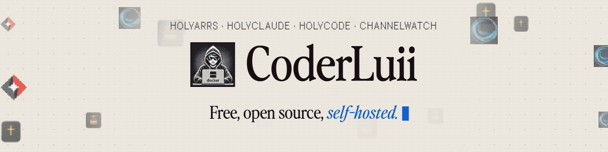
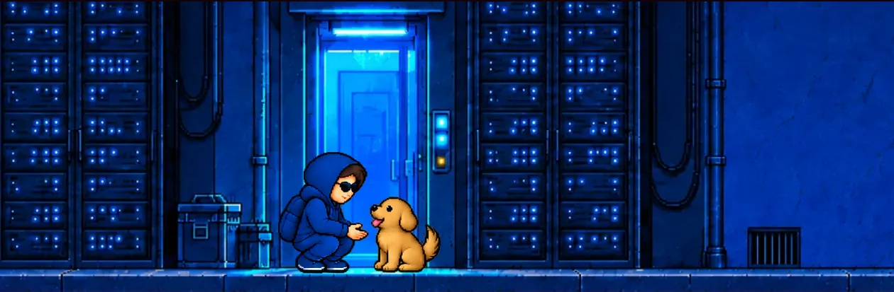

<picture>
  <source media="(prefers-color-scheme: dark)" srcset="assets/sponsors-banner-dark.gif">
  
</picture>

 

Hey, I'm Luis.

Security engineer by day, 10+ years into software and security. At night I build the tools I wish already existed.

Every project here started the same way. Something took me hours to set up, so I packaged it until it takes you *one command*.

That habit now has 350k+ Docker pulls and 2,700+ stars behind it. Not bad for a night shift.

Next up is **HolyArrs**: one app for your movies, shows, music and requests, instead of the six most media servers run today.

 

## 🛠️ What I'm building

<table>
<tr>
<td width="50%" align="center" valign="top">
 

### [HolyClaude](https://github.com/CoderLuii/HolyClaude)

Claude Code, a web UI, 5 AI CLIs, a headless browser and 50+ dev tools in one Docker container.

  
</td>
<td width="50%" align="center" valign="top">
 

### [HolyCode](https://github.com/CoderLuii/HolyCode)

OpenCode in Docker. 30+ dev tools, 10+ AI providers, a headless browser and state that sticks around.

  
</td>
</tr>
<tr>
<td width="50%" align="center" valign="top">
 

### [ChannelWatch](https://github.com/CoderLuii/ChannelWatch)

Live alerts for Channels DVR. See what's playing, who's watching and how much disk is left.

  
</td>
<td width="50%" align="center" valign="top">
 

### [HolyArrs](https://github.com/HolyArrs)

One app for your movies, shows, music and requests, instead of six. Free and open source when it launches.

  
</td>
</tr>
</table>

<a href="https://github.com/HolyArrs">
<picture>
  <source media="(prefers-color-scheme: dark)" srcset="https://raw.githubusercontent.com/HolyArrs/.github/main/profile/banner-dark.gif">
  
</picture>
</a>

> [!TIP]
> **[HolyCode Cloud](https://holycode.cloud) is live.** A cloud workstation with Claude Code, Codex, Gemini, OpenCode and 60+ tools already installed. Root on your own machine, flat monthly, no meter. [Get started →](https://holycode.cloud)

 

## 🧰 Tools I reach for

<table align="center">
<tr>
<td align="center" width="25%">
 <b>LANGUAGES</b>  
<picture>
  <source media="(prefers-color-scheme: dark)" srcset="https://skillicons.dev/icons?i=python%2Cjs%2Cts%2Cgo&theme=dark">
  
</picture>
  
</td>
<td align="center" width="25%">
 <b>WEB</b>  
<picture>
  <source media="(prefers-color-scheme: dark)" srcset="https://skillicons.dev/icons?i=svelte%2Cvite%2Castro%2Ctailwind&theme=dark">
  
</picture>
  
</td>
<td align="center" width="25%">
 <b>INFRA &amp; RUNTIME</b>  
<picture>
  <source media="(prefers-color-scheme: dark)" srcset="https://skillicons.dev/icons?i=docker%2Clinux%2Ccloudflare%2Cnodejs&theme=dark">
  
</picture>
  
</td>
<td align="center" width="25%">
 <b>AUTOMATION</b>  
<picture>
  <source media="(prefers-color-scheme: dark)" srcset="https://skillicons.dev/icons?i=bash%2Cpowershell%2Cgit%2Cgithubactions&theme=dark">
  
</picture>
  
</td>
</tr>
</table>

 

## 📈 On GitHub

<picture>
  <source media="(prefers-color-scheme: dark)" srcset="https://github-profile-summary-cards.vercel.app/api/cards/stats?username=CoderLuii&theme=github_dark">
  
</picture><picture>
  <source media="(prefers-color-scheme: dark)" srcset="https://github-profile-summary-cards.vercel.app/api/cards/most-commit-language?username=CoderLuii&theme=github_dark">
  
</picture>
 

